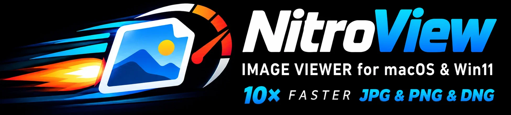

<p align="center"></p>

# jpeg-nitro

**English** | [Magyar](README.hu.md)

**nitroview** is a very fast image viewer for **macOS (Intel and Apple Silicon), Windows and
GNOME/Linux**:

| platform | viewer | build |
|---|---|---|
| macOS 12+, Intel and Apple Silicon | Cocoa + Metal: a universal `nitroview.app` | `make app` / `make dmg` |
| Windows 10+ | Win32 + Direct3D 11: one self-contained `nitroview.exe` | `make windows` (llvm-mingw) |
| Linux with GNOME | GTK 4 + libadwaita: `nitroview-gnome`, also as a Flatpak | `make gnome` / `make flatpak` |
| Linux (Wayland / X11), new | SDL3 + OpenGL 3.3: one self-contained `nitroview-sdl` | `make sdl` / `make sdl-dist` |

Ready-made builds for all four: [Releases](https://github.com/gereoffy/jpeg-nitro/releases). The macOS
dmg there is **notarized**: it opens without a Gatekeeper warning.

All four are built on our own decoders: three that decode a *single* image on all CPU cores —
although JPEG, PNG and PSD compression are all sequential by design —, one that decodes the tiles of
HEIC photos in parallel, one that develops DNG raw images, one for WebP, one for TIFF, one for AVIF (with dav1d), and two for vector drawings:

| decoder | format | how | time | usual decoders |
|---|---|---|---|---|
| **nitrojpeg** | baseline and progressive JPEG | speculative parallel Huffman decoding, AVX2 IDCT; progressive: the scans as a pipeline, row by row; bit-exact with libjpeg-turbo | 24 MP photo: **~11 ms**; progressive: **~79 ms** | libjpeg-turbo ~107 ms (1 thread); progressive ~336 ms |
| **nitropng** | PNG (non-interlaced; palette, 1–16-bit, transparency key too) | speculative parallel inflate (back-references into not yet known data resolved later, Adler-32 verified) + "wavefront" filter reversal | 38 real PNGs: **~43 ms** avg. | Wuffs ~171 ms, ImageIO ~318 ms |
| **nitropsd** | Photoshop PSD/PSB (8-bit RGB / gray) | merged image: RLE rows in parallel, ZIP via nitropng's inflate; reads only the merged image of huge layered files | 24 MP RLE: **~5 ms** | ImageIO ~170 ms |
| **nitroheic** (macOS) | HEIC (8-bit 4:2:0 HEVC, iPhone grids) | own HEIF parsing; the 48 independent HEVC tiles of an iPhone photo decoded in parallel by VideoToolbox into Y/Cb/Cr for the GPU | 12 MP iPhone photo: **~33 ms** | ImageIO ~200 ms |
| **nitrodng** | DNG raw (Bayer; lossless JPEG or uncompressed) | own raw development: lossless JPEG in parallel (a single strip too: speculative Huffman decoding, as in nitrojpeg), black / white levels, white balance, Malvar–He–Cutler demosaicing, colour matrix, tone curve | 20 MP DNG: **~8 ms**; 25 MP in one lossless JPEG strip: ~22 ms | ImageIO 210–510 ms / 490–630 ms |
| **nitrowebp** | lossy WebP (VP8) | own VP8 decoder (RFC 6386): the coefficient tokens (one serial stream) on one thread, the modes and the reconstruction on others; Y/Cb/Cr for the GPU | 42 MP WebP: **~100 ms**; 137 everyday WebPs: **27 ms** avg. | ImageIO ~360 ms; 54 ms |
| **nitrotiff** | TIFF (none, PackBits, LZW, Deflate, CCITT G3 / G4; 1–16-bit gray, palette, RGB, CMYK, alpha; strips / tiles, chunky / planar) | strips and tiles in parallel (Deflate also through nitropng's parallel inflate); uncompressed: converted straight from the file, in parallel | 13 MP 16-bit scan (73 MB): **~2 ms**; 17 MP LZW: **~6 ms** | ImageIO ~31 ms; ~46 ms |
| **nitroavif** | AVIF (AV1 in HEIF: 8–12-bit, 4:2:0 – 4:4:4, gray, alpha, grids, crop / rotation / mirroring) | own HEIF parsing (shared with nitroheic), AV1 by [dav1d](https://code.videolan.org/videolan/dav1d); grid tiles decoded in parallel, our own parallel colour conversion (chroma upsampled linearly) | 41 web AVIFs: **~10 ms** avg. (M1: 10.8 ms; Windows i5: 13 ms) | ImageIO ~32 ms (M1: 22 ms); WIC: only with a Store extension |
| **nitrosvg** | SVG (without filters) | lunasvg parser + plutovg renderer, with font lookup in the system and user font folders | 38 MB SVG: **~0.53 s** | WebKit ~1.4 s, CoreSVG ~2.4 s |
| **nitrocdr** | CorelDRAW 5 – X6 (CDR), CMX | our [libcdr fork](https://github.com/gereoffy/libcdr) with many fixes (text styles, line spacing, clipping, bitmap transparency) and a 2× faster librevenge; draws directly with plutovg | 17.7 MB all-vector CDR: **~1.8 s**, ~3× faster | original libcdr `cdr2xhtml` ~5.4 s (only converting to SVG) |

Times on an Intel i9. The decoders are fast on ARM too (NEON): on a 2020 M1 MacBook Air a
24 MP JPEG decodes in ~30 ms, ~3× faster than Apple's hardware JPEG decoder on the same machine
([Apple Silicon](#apple-silicon-m1)). They are plain C files without dependencies and can be
used on their own ([Using the decoders](#using-the-decoders)). Photo series such as timelapses can be "played
back" at full resolution in real time, up to 60 images/s. On macOS and Windows **Canon CR2**, **Nikon NEF**, **Sony ARW** and **Fujifilm RAF** raw files show
the full-size JPEG the camera stored in them (nitrojpeg, in milliseconds instead of ImageIO's
150–400 ms; their rotation is honoured); **DNG** raw images (drones, Leica, Ricoh, phones,
Adobe DNG Converter) are developed by nitrodng (`src/nitrodng.c`) at full resolution — a quick look at
what is in the picture, not a raw converter: no noise reduction, lens corrections or other
DNG opcodes. On macOS **HEIC** photos (iPhone) are decoded by
nitroheic (`src/nitroheic.c`): an iPhone photo is a grid of 48 independent HEVC tiles, decoded here
in parallel (Intel: software VideoToolbox decoders, one per core; Apple Silicon: 4 sessions on the
media engine) into Y/Cb/Cr planes converted on the GPU — 12 MP in ~33 ms instead of ImageIO's ~200 ms
on an Intel i9 (M1: see [below](#apple-silicon-m1)). Lossy **WebP** images are decoded by nitrowebp
(`src/nitrowebp.c`: 2× faster than ImageIO on everyday web images and on 24 MP photos at quality 90,
3–5× on large web images; no loop filter yet, which is hard to see). **TIFF** images are decoded by nitrotiff
(`src/nitrotiff.c`, [below](#tiff-nitrotiff)). JPEG-compressed TIFF, lossless or transparent WebP, GIF, BMP and other HEICs open
through Apple ImageIO on macOS, WIC on Windows and GTK's loaders on Linux (see **Windows** and
**GNOME / Linux** below). On macOS and Windows it also shows vector drawings, **SVG** (lunasvg) and
**CorelDRAW** CDR / CMX (libcdr, our fork with many fixes), sharp at any zoom and paging as fast
as photos (see **SVG** and **CorelDRAW** below); the GNOME viewer shows them the same way.
(The name: racing cars boost the turbo with nitro.)

Developed and measured on an Intel x86-64 Mac (i9 13th gen, 8 cores / 16 threads, AMD RX 580).
Also runs on Apple Silicon (M1 MacBook Air, see [below](#apple-silicon-m1)); there the IDCT uses NEON instead of AVX2.

```
./nitroview [-f] [-s ms] [-j threads] image.jpg ... | directory/
```

| key | action |
|---|---|
| PgDn / Space | next image |
| PgUp / Backspace | previous image |
| Home / End | first / last |
| [ / ] | previous / next page of a multi-page CorelDRAW drawing (title: [page 2/5]) |
| + / − | zoom in / out (√2 steps, stops exactly at 100% and at fit) |
| 0 | fit to the screen: small images are enlarged too (stays on while paging, until W) |
| 1 | actual size: one image pixel = one screen pixel |
| 2 … 8 | 200% … 800%, pixel-exact: one image pixel = N×N screen pixels |
| ← → ↑ ↓ | move a zoomed image (Shift: half a screen per step) |
| W | back to the image's own size (small images at 100%), window follows image sizes again |
| E / Shift + E | DNG raw images: brighter / darker by 1/3 EV (up to ±3 EV; kept while paging, shown in the title) |
| Del (Mac: also ⌘ + Backspace) | delete: the file is moved to the `.delete` folder next to it (hidden), the next image follows; nothing is lost |
| U / Ctrl + Z (Mac: ⌘ Z) | undo the last delete: the file goes back to its place |
| mouse drag | move a zoomed image |
| scroll wheel | zoom around the point under the cursor (one √2 step per notch; trackpad: smooth, pinch too) |
| double click | fit → 100% at the clicked point; again → back to fit |
| right click / Shift + right click | next / previous image |
| Ctrl + scroll wheel | previous (forward) / next (back) image; trackpad: one image per 40 px |
| mouse side buttons (back / forward) | previous / next image |
| F / Enter | toggle full screen (`-f`: start in full screen) |
| P | pause / resume the slideshow |
| Esc / Q | quit (Esc in full screen: back to a window) |

**One file given** (e.g. from Midnight Commander or the Finder): paging moves through the other
images of its folder, in Finder order. The folder is listed only on the first paging key, so macOS
asks for folder access only if you actually page.

**Passing the app on:** `make zip` or `make dmg`. The app is only ad-hoc signed, so on another Mac
macOS refuses it the first time: right-click → Open (up to macOS 14), or System Settings → Privacy &
Security → Open Anyway (macOS 15), or `xattr -dr com.apple.quarantine nitroview.app`. With an Apple
Developer ID it opens without that: `make dmg notarize SIGN_ID="Developer ID Application: Name
(TEAMID)" NOTARY_PROFILE=name` signs it (hardened runtime), has Apple notarize the dmg and staples the
ticket to it (once before: `xcrun notarytool store-credentials name`). The dmg in the
[Releases](https://github.com/gereoffy/jpeg-nitro/releases) is such a notarized build: made from the
release's tag by the workflow in `.github/workflows/macos-release.yml` on a GitHub Actions macOS runner
in [mgelei's fork](https://github.com/mgelei/jpeg-nitro), signed with their Developer ID
(`gh attestation verify nitroview-vN.dmg --repo mgelei/jpeg-nitro` checks the provenance).

**Finder:** `make app` builds `nitroview.app`. Copy it to /Applications, then in the Finder: Get Info
on an image → Open with → nitroview → Change All. Images or folders can also be dropped on its Dock
icon or its window, or chosen with nitroview → Open… (⌘O); a running viewer takes the new file(s).

**Windows:** `nitroview.exe` ([src/nitroview_win.c](src/nitroview_win.c), Win32 + Direct3D 11) is
the same viewer: the same keys, mouse, zoom and window behaviour, full screen, slideshow, one file →
its folder, drag & drop, O / Shift+O: open files / a folder (the dialog also comes up when started
without files). JPEG / PNG / PSD go through the three decoders and a compute shader,
HEIC photos through our own HEVC decoder (`src/nitrohevc.c`, written from the H.265 specification:
Windows has no HEVC decoder without a Store extension; its tiles in parallel, ~55 ms for 12 MP; no
deblocking / SAO yet, which is hard to see), DNG raw images through nitrodng, lossy WebP through nitrowebp, TIFF through
nitrotiff, AVIF through nitroavif + dav1d (Windows needs a Store extension for AV1 too), everything else (JPEG-compressed TIFF, lossless or transparent WebP, GIF, BMP)
through Windows' own WIC codecs;
SVG and CorelDRAW CDR / CMX as on macOS (sharp when zoomed in, [ / ] for the pages of a drawing).
One self-contained .exe (only system DLLs, Windows 10 or later), built on the Mac or on Linux with
`make windows` (see [Other systems](#using-the-decoders)). `nitroview.exe --register` offers it for
all these types in Explorer (current user, no admin rights) and opens Settings → Default apps, where
you pick it (Windows lets only the user choose the default); `--unregister` removes it again.
Opening files while it runs shows them in the running window (`-n`: a new one). Not there yet:
colour management (images are shown as sRGB); touchpad gestures are untested.

**GNOME / Linux:** `nitroview-gnome` ([src/gnome/](src/gnome), GTK 4 + libadwaita, contributed by
Ferenc Czirok) has the same keys, mouse and trackpad gestures, zoom and pan, full screen, slideshow
(`-s`), one file → its folder, drag & drop and an Open dialog, Del / U and E / Shift+E. JPEG, PNG,
PSD, HEIC (through nitrohevc), lossy WebP, DNG and the JPEG of camera raw files go through our
decoders (linked in statically), SVG and CorelDRAW CDR / CMX through nitrosvg / nitrocdr (sharp when
zoomed in, [ / ] for the pages, when `scripts/get-deps.sh` has fetched them); the JPEG colour conversion is multi-threaded and gives exactly
libjpeg-turbo's RGB (`bench/rgbverify`), PNG rows go to GTK without a copy, and the EXIF
orientation is applied when drawing. Images are decoded on a background thread with the same
prefetch as on macOS / Windows (3 ahead, 2 behind). Everything else (TIFF, GIF,
lossless WebP ...) is opened by GTK's own loaders. The window opens at the size of the first image,
W sets it to the image again, 0 maximizes it; it keeps its size while paging (under Wayland an
application cannot move its window, so it does not grow it freely). `make gnome` needs GTK 4.6+ and
libadwaita 1.1+ (Ubuntu 22.04; there clang also needs `libstdc++-12-dev` for nitrosvg). Before GTK
4.10 textures are drawn only with a linear filter: large images get mipmaps made on the CPU, and the
pixel-exact 200–800% zoom is smoothed. `make gnome-register` adds it to the desktop for the current
user; `make flatpak` builds `nitroview-gnome.flatpak` on the GNOME 50 runtime (with Flathub's
`org.flatpak.Builder` if installed: older distributions' own flatpak-builder, e.g. Ubuntu 22.04's,
cannot finish a GNOME 50 build).

**SDL3 / Linux (new, being tested):** `nitroview-sdl` ([src/nitroview_sdl.c](src/nitroview_sdl.c))
is the Windows viewer's structure on SDL3 + OpenGL 3.3 instead of Win32 + Direct3D: the same keys and
mouse (+ O: open files, Shift+O: a folder), window behaviour, prefetch, Del / U, E / Shift+E, SVG / CorelDRAW with sharp
zoom, `--bench` and `--selftest`, and the same GPU path (planes as textures, YCbCr→RGB in a shader,
mipmaps, trilinear drawing; pixel-exact 200–800%). Whatever our decoders don't take (interlaced
PNG, GIF, BMP, damaged or CMYK JPEG) goes to stb_image. SDL3 is linked in statically;
OpenGL and Wayland / X11 are loaded at run time, so it needs no GTK. `scripts/get-deps.sh` builds
SDL3 (the window systems' development packages it needs are listed there). It builds on macOS too,
only for testing (there OpenGL is slow; the Metal viewer stays the real one). `make sdl-dist` makes
the one file to give away, `nitroview-linux-x64.tar.gz` (4 MB): built for x86-64-v3 (AVX2) instead
of the build machine's CPU, libstdc++, zlib and dav1d linked in, it needs only glibc (2.35+ when built
on Ubuntu 22.04). On 64-bit ARM Linux (Asahi Linux on Apple M1 / M2, Raspberry Pi 4 / 5) the same
makes `nitroview-linux-arm64.tar.gz`, built for armv8-a (the NEON code paths are the ones the Mac's arm64
build uses; HEIC is decoded by nitrohevc, as on x86 Linux); tried on an M1 MacBook Air under Fedora Asahi Remix 44
(KDE Plasma on Wayland, Mesa's OpenGL 4.6 driver for the M1 GPU): 100% stays pixel-exact at 200% and 300% display scaling too. `nitroview-sdl --register` adds it to the desktop's applications for the current user
(a desktop file and the icon in `~/.local/share`: "Open with" in the file manager), `--unregister`
removes it.

**AVIF** (nitroavif, `src/nitroavif.c`): AV1 stills in a HEIF container, as webshops and
CDNs send them more and more. The HEIF structure is read by our own code (`src/heif.h`, shared with
nitroheic), AV1 is decoded by [dav1d](https://code.videolan.org/videolan/dav1d) (VideoLAN,
BSD-2-Clause, built by `scripts/get-deps.sh` with meson + ninja in a Python virtual environment),
the colour conversion is ours, in parallel: 8 / 10 / 12-bit, 4:2:0 / 4:2:2 / 4:4:4 / gray, BT.601 /
709 / 2020 / RGB matrices, full or limited range, alpha over black, grids of tiles decoded in
parallel. Both Linux viewers use it (GTK has no AVIF loader without an extra package), and so does
the macOS viewer when `scripts/get-deps.sh` has built dav1d (universal: x86_64 + arm64; `make
DAV1D=0` leaves AVIF to ImageIO), and the Windows viewer when `WINCC=… scripts/get-deps.sh` has
cross-compiled it (`third_party/dav1d-win`; otherwise WIC, with the AV1 Store extension). Decoding 41 AVIFs saved from
webshops and news sites (300×200 … 3000×3000), ms/image: i9 (macOS) ImageIO 31.7 → nitroavif 10.0, M1
22.4 → 10.8, i5-9600K (Windows) 13.0 (WIC without the Store extension: none of them). The same pixels within ±1 for 4:4:4 and for luma,
4:2:0 chroma differs at colour edges because ImageIO repeats chroma samples where we interpolate
linearly (as for JPEG). Checked on the AOM test files ([av1-avif](https://github.com/AOMediaCodec/av1-avif))
and [Link-U's samples](https://github.com/link-u/avif-sample-images) against their PNG references:
every bit depth, chroma format, monochrome, limited-range alpha, grids, layered images (a1op, data
in several pieces), crops (also after a rotation, in the order the properties give) and mirroring
match them; ImageIO gets several of these wrong (limited-range gray and alpha, the crop after a
rotation, profile 2 files it cannot decode). Not handled: a grid of layered tiles (two Apple test
files). The output is identical on Linux and with any thread count; damaged files run clean under
AddressSanitizer. (This also fixed nitroheic's `imir` axis: 0 exchanges top and bottom.)

The window is sized to the image: at exactly 100% if it is smaller than the screen, otherwise
with the image's aspect ratio as large as fits (no black bars). When zooming in, the window grows with the image up to the screen
size (and shrinks back when zooming out; 0 restores it). When paging, it follows each image's
size (keeping its centre), except while zoomed in: then the window, zoom and position stay. After you resize the window yourself (edge drag, green button, tiling) it keeps that
size; W brings it back to the image size and turns the automatic sizing back on. The title shows the zoom level right after the file name. Integer zoom levels (200%, 300%,
400%, … also when reached with the wheel or +/−) show the pixels as exact square blocks;
other levels are smoothly interpolated. Paging stops at the first and last image. **Zoom and position are kept when paging**, so in
a burst or series you can zoom into a detail (e.g. the eyes) and page through to find the
sharpest shot. Wheel zoom keeps the point under the cursor in place, except while the image is narrower
than the window along an axis: it stays centred there until it fills the window. If Ctrl + scroll zooms the whole screen instead, macOS Accessibility zoom is set to use
Ctrl with the scroll gesture (System Settings → Accessibility → Zoom). If pinching does nothing, the
gesture is turned off (System Settings → Trackpad → Scroll & Zoom → Zoom in or out). The zoom keys work by character, so they work on any keyboard layout and the
numeric keypad; the title shows the current zoom. The window title shows the file name, size and
decode time; stdout gets one line per image with read time, decode time and the
key → on-screen latency. EXIF orientation is honoured.

**Slideshow:** `-s <ms>` (or `--slideshow <ms>`): the next image comes when the current one
has been on screen for `ms` milliseconds (`-s 2000` is a classic slideshow, `-s 40` is
~25 images/s). If an image takes longer to load, it waits, so no image is skipped. It stops
at the last image; P pauses; the paging keys keep working and the slideshow continues from
there. Timing follows the display refresh (±8 ms at 60 Hz). Run without arguments (or `-h`)
for the full list of options.

**Other formats:** besides JPEG, nitroview opens PNG, PSD/PSB, HEIC/HEIF, TIFF, WebP, GIF and BMP.
PSD/PSB: the merged (composite) image is shown, decoded by **nitropsd** for 8-bit RGB and
grayscale files (all four compressions: raw, RLE, ZIP, ZIP with prediction), otherwise by Apple
ImageIO — which cannot read ZIP-compressed PSDs at all. A 24 MP RLE PSD decodes in ~5 ms
(ImageIO: ~170 ms), ZIP in ~46 ms: the RLE row table gives every row's position, so all rows
are unpacked in parallel; ZIP uses nitropng's parallel inflate. Big layered PSDs are mostly layer
data (the merged image is often only 13–23% of the file), so the viewer reads just the header,
the image resources (ICC profile) and the merged image: a 482 MB PSD loads in ~20 ms instead of
~155 ms.
Merged transparency (negative layer count): Photoshop stores the colour matted with white — in a
test file every partially transparent pixel had every channel ≥ 255 − alpha — so nitropsd shows it
over black as max(0, colour + alpha − 255). ImageIO does not remove the matte (light fringes on
soft edges). A 4th channel with a positive layer count is a saved selection, not transparency.
Files saved without "Maximize Compatibility" contain only a white placeholder instead of the merged
image; the layers are not composited, so they show white (as in ImageIO). On 55 real PSDs
(Photoshop work, maps, architecture) the result matches ImageIO except for these two points. PNG is decoded by **nitropng**, our own parallel PNG decoder
(non-interlaced: 8-bit gray / RGB / RGBA go to the GPU as they are; palette, 1 / 2 / 4 / 16-bit and
transparency-key PNGs are converted to BGRX in parallel), the rare interlaced ones by Apple
ImageIO like the other formats (or [Wuffs](https://github.com/google/wuffs) first with `make WUFFS=1`). Transparent images are shown over black. On 38 real PNGs
(screenshots, scans, AI images, upscaled textures, Photoshop exports) nitropng averages
**~43 ms/image** vs ~171 ms for Wuffs and ~318 ms for ImageIO; see [nitropng](#nitropng). On 25
palette / 1–16-bit / transparency-key PNGs the viewer's decode went from 53 (Wuffs) to 18 ms/image,
pixel-identical with ImageIO (`bench/bgrxverify`; a 26 MP 16-bit RGB from ~940 to ~195 ms).

**SVG** (macOS and Windows, when `scripts/get-deps.sh` has fetched [lunasvg](https://github.com/sammycage/lunasvg)):
rendered by lunasvg over white, first in full with the long side 1024–4096 pixels (small icons are
enlarged, huge drawings reduced; fitted to the screen, in full screen or after key 0, at least
the screen's size, the prefetched images too, so they are sharp right away), so paging, fitting and zooming out work as for photos. Zoomed in
beyond that, the visible part is rendered again at screen resolution once the zoom or position has
been still for ~80 ms (typically 5–40 ms); until then the previous rendering is scaled, so pinching
stays smooth and the picture sharpens when it stops. Supported: shapes, paths, gradients, clipping,
masks, patterns, `<style>` style sheets, text (with the system fonts), embedded images; before
parsing, nitrosvg also fixes three things lunasvg would get wrong: `svg:`-prefixed elements
(LibreOffice), CSS `var(--x, fallback)` colours (VS Code's images: the fallback, or without one the inherited
value; black squares otherwise) and SVG 1.1 line breaks in text
(old exporters split words over lines). `patches/lunasvg.patch` (applied by `scripts/get-deps.sh`)
fixes lunasvg itself: a repeated closepath (`ZZ`) lost the rest of the path, and masks zoomed in
far allocated layers the size of the whole element (a crash). Not
supported: filters (drop shadows and blurs are left out), HTML labels in `<foreignObject>` (draw.io
diagrams), SVG fonts and symbol-only sprite files, which draw nothing. Of 883 SVGs collected from a
Mac (icons, logos, diagrams, Illustrator exports) 867 open; the 16 others draw nothing in a browser
either.

**CorelDRAW** (CDR and CMX, macOS and Windows, when `scripts/get-deps.sh` has fetched libcdr): libcdr (from
LibreOffice, used by Inkscape and LibreOffice Draw too) reads the drawing; nitrocdr
(`src/nitrocdr.cpp`) records what it reports as a display list and draws it with plutovg directly,
without an SVG step, so embedded scans and photos stay decoded bitmaps in memory. The shown area is
the drawing's bounding box (with a small margin), not the page size set in the file, so a small logo
fills the window; the pages of a multi-page document share one area (the bounding box of all of
them), so what lies above each other on them, like the floors of a building, stays in place when
paging. Paging, zooming and the sharp detail work as for SVG ([ and ] switch between the pages,
keeping the zoom and the position). libcdr comes from our fork,
[gereoffy/libcdr](https://github.com/gereoffy/libcdr), which has the fixes this needed, one commit
each: open paths are not filled; text keeps its rotation, its horizontal stretch, bold and italic, its
exact size and the shifts that place the words of imported PDF text, and is placed at its real origin; `CMYK100` colours (CorelDRAW 2022) are not white; objects on hidden layers
are skipped (an imported PDF keeps its switched-off layers as hidden layers); symbol definitions do
not make an extra page; bitmaps keep their transparent background and are cut to their own outline (the wall hatch of imported plans); texts lost in CorelDRAW 5 and 7–X5
files show; and ICU is replaced by iconv (code pages; without a charset, windows-1250 when the text
has ő/ű). `patches/librevenge.patch` lets embedded images through without base64. Fonts come from /Library/Fonts,
/System/Library/Fonts and ~/Library/Fonts (Bitstream names such as "Futura Lt BT" map to the
family); a missing font is replaced by a similar one, so its text may run a little longer or
shorter. Lines are never thinner than one device pixel, as in CorelDRAW. Not supported: arrowheads, Corel's own vector and
bitmap pattern fills. On 216
CDRs collected from a Mac (architectural plans from ArchiCAD PDFs, network maps, logos) every file
opens; on an Intel i9 the median takes 20 ms, the 76 files over 1 MB 230 ms on average, the
biggest plan 1.8 s (mostly libcdr's parsing). On macOS the C++ code
(libcdr, librevenge, lunasvg) allocates through [mimalloc](https://github.com/microsoft/mimalloc):
loading a big plan makes millions of small allocations, and with it plans load 20–25% faster on
Intel and Apple Silicon too (`make MIMALLOC=0`: the system malloc).

**Colour management:** embedded ICC profiles are honoured for every format (e.g. Display P3
from iPhones and Mac screenshots, Adobe RGB scans); images without a profile are treated as
sRGB. The decoded pixel values are left as they are and the display layer is tagged with the
image's colour space, so macOS converts to the monitor's profile at no extra cost and wide-gamut
colours are kept.

`-j N` limits the decoder to N threads (default: all logical CPUs). With 8 threads decoding
takes ~15.4 ms/image instead of 11.8, but heats the CPU less.

Other modes:
- `--bench files…`: load everything without a window (read, decode, GPU) and print timings.
- `--selftest files…`: compare the GPU colour conversion with libjpeg-turbo's output.
- `--zoomtest files…`: replays zoom/pan key sequences offscreen and checks that at 100% every
  drawn pixel equals the decoded image (plus edge clamping and zoom snapping).
- `--inputtest files…`: sends synthesized mouse and wheel events and checks paging and zoom.
- `--auto <ms>`: test mode: pages every `ms` (even if the image isn't shown yet) and quits
  at the end. For latency measurements.

## Results (50 photos, mostly 6000×4000, 17 MB on average)

**Full load in the viewer: ~23 ms/image** (file read 3.5 + decode 12 + GPU 7).
When paging, a prefetched image reaches the screen in **7–20 ms** (one frame at 60 Hz).
A folder of 24 MP images plays back continuously at **~60 images/s** (the display refresh
rate), also from an SSD with nothing cached.

### Decoder comparison (`bench/bench`, decode only, from memory)

| decoder | ms/image |
|---|---|
| Apple ImageIO (CGImageSource) → BGRA | 274 |
| Apple ImageIO, native buffer | 249 |
| stb_image | 175 |
| Wuffs | 159 |
| ImageIO thumbnail 3000 px (DCT scaling) | 159 |
| VideoToolbox (JPEG; no HW JPEG on this machine, runs in software) | 157 |
| libjpeg-turbo 3.1.2 (AVX2), BGRX | 124 |
| libjpeg-turbo, fast DCT + fast upsampling | 112 |
| libjpeg-turbo → YUV planes (no colour conversion) | 107 |
| libjpeg-turbo, 1/2 scale | 100 |
| libjpeg-turbo, 1/4 scale | 96 |
| nitrojpeg, own engine, **1 thread** → YUV | 103 |
| nitrojpeg, old engine (libjpeg-turbo decodes the bands) → YUV | 20.6 |
| **nitrojpeg, own engine, parallel → YUV planes** (used by the viewer) | **11.7** |

1/4 scale barely helps, so most of the time goes into Huffman decoding, which is
inherently sequential in JPEG. Most camera JPEGs have no restart markers, so libjpeg-turbo
can't parallelise within one image. The RX 580 has no hardware JPEG decoder.

### Apple Silicon (M1)

A 2020 M1 MacBook Air (4 performance + 4 efficiency cores, no fan), `bench/bench` on 43 of the
photos (`samples/*.JPG`, 765 MB), ms/image. Raw output, also with the i9 on the same 43 files:
`bench/results/m1.txt`.

| decoder | ms/image |
|---|---|
| stb_image | 384 |
| Wuffs | 217 |
| libjpeg-turbo, BGRX | 185 |
| libjpeg-turbo → YUV planes | 168 |
| Apple ImageIO → BGRA | 108 |
| Apple ImageIO, native buffer | 89 |
| VideoToolbox | 88 |
| ImageIO thumbnail 3000 px | 67 |
| nitrojpeg, **1 thread** → YUV | 154 |
| **nitrojpeg, parallel → YUV** | **30.4** |

On the M1, ImageIO and VideoToolbox decode JPEG in hardware: 2.5–3× faster than the software
path on the i9 (table above). nitrojpeg (NEON IDCT, 8 threads) is still ~3× faster than that
hardware at full size and 5.5× faster than libjpeg-turbo. One M1 core is ~1.5× slower than an i9
core on this work (1 thread: 154 ms, the i9 103 ms in the table above); the threads scale well: 2 → 81 ms, 4 → 46 ms, from 6 on 33–36 ms (the four
efficiency cores add roughly one performance core). The NEON IDCT brought 8 threads from 43 to
31 ms. The default (one thread per core, 8) is the best setting there.

PNG (`bench/pngbench samples_png/real/*.png`: 34 real PNGs, 938 MB, 805 Mpixel — screenshots,
scans, AI images, maps; ms/image):

| decoder | M1 | i9 |
|---|---|---|
| Apple ImageIO, native buffer | 364 | 345 |
| Apple ImageIO → BGRA | 392 | 376 |
| Wuffs → BGRA | 272 | 180 |
| nitropng, 1 thread | 326 | 223 |
| **nitropng, parallel** | **90** | **45.5** |

There is no hardware PNG decoder, so ImageIO is equally slow on both. On the M1 nitropng is 3×
faster than Wuffs and 4× faster than ImageIO. Its Adler-32 and back-reference resolving use NEON
there (AVX2 on x86): that took it from ~100 to 90 ms; most of the time is Huffman decoding
and the row filters, which are plain C on both.

HEIC (a small test program, not in the repository: the 48 tiles of 20 iPhone photos, 12 MP, through VideoToolbox in
different ways, decoder sessions included; the last row: `nitroview --bench` on all 155; ms/image):

| decoder | M1 | i9 |
|---|---|---|
| Apple ImageIO | 58–60 | 176 |
| VideoToolbox hardware, 1 session | 52 | 135 |
| VideoToolbox hardware, 4 (M1) / 8 (i9) sessions | **24–29** | 224 |
| VideoToolbox software, 4 / 8 sessions | 62–75 | **42** |
| **nitroheic** (in the viewer) | **25** | **33** |

The M1's media engine serves 4 tiles at once, the i9's Radeon RX 580 one at a time (it is slower
with more sessions), while the software decoder scales with the cores: so nitroheic uses the
hardware on Apple Silicon and one software decoder per core on Intel.

WebP (`nitroview --bench` on everyday lossy WebPs from the web, without synthetic noise and quality 90
photos: 119 files on the M1, 137 on the i9; decode, ms/image):

| decoder | M1 | i9 |
|---|---|---|
| Apple ImageIO | 42.9 | 54.2 |
| **nitrowebp** | **25.5** | **27.2** |

WebP has no hardware decoder either. nitrowebp's pace is set by its one serial stream of
coefficient tokens, where a single M1 core does well, and so does ImageIO there: 1.7× on the M1,
2× on the i9.

DNG (`nitroview --bench` on the 14 DNGs of [DNG raw images](#dng-raw-images-nitrodng); decode, ms/image):

| decoder | M1 | i9 |
|---|---|---|
| Apple ImageIO | 401 | 360 |
| **nitrodng** | **34.4** | **22.5** |

ImageIO shows the three Leica M9 DNGs only as their 320×216 previews, which makes its average
look better; nitrodng develops all of them at full size, 12× faster on the M1, 16× on the i9.

Progressive JPEG (`nitroview --bench` on 100 progressive web JPEGs over 1 MB, 5.8 MP on average;
decode / with the GPU upload and conversion, ms/image):

| decoder | M1 | i9 | i5-9600K, Windows |
|---|---|---|---|
| libjpeg-turbo (TurboJPEG, the viewer's earlier path on macOS) | 43.4 / 47.1 | 41.9 / 47.9 | |
| WIC (the viewer's earlier path on Windows) | | | 118 / 128 |
| **nitrojpeg** (the scans as a pipeline) | **10.6 / 15.8** | **9.5 / 14.3** | **11.0 / 18.3** |

4× faster on the M1, 4.4× on the i9, 10.7× faster than WIC on the i5 (6 cores without
hyper-threading; the Windows viewer also builds mipmaps, 1.5 ms). On the i5 one thread takes
29.3 ms (`bench/nbench -1`), 4 workers 11.0, 6 workers (`-j 6`) 11.8. The 16-bit IDCT (pmaddwd / vmlal) made a difference only on
one thread (its 32-bit vector multiplies are slow on the i9); 4 workers instead of all cores took
the M1 from 11.3 to 10.6 ms and the i9 from 11.7 to 9.5 ms (more can't be kept busy, see
[Progressive JPEG](#progressive-jpeg); `-j` sets more).

### Three machines, macOS and Linux

`bench/nbench` (portable, same code on every system), best of 5 decodes, ms/image; JPEG: the 50
sample photos, PNG: the 34 real PNGs above. The M1 row is from `bench/bench` / `bench/pngbench`
(JPEG: 43 of the photos).

| machine | JPEG, parallel | JPEG, 1 thread | PNG, parallel | PNG, 1 thread |
|---|---|---|---|---|
| Intel i9 13th gen, 8 cores / 16 threads, macOS | **8.7** | 96 | **37.6** | 216 |
| Apple M1, 4 + 4 cores, macOS | **30.4** | 154 | **90** | 326 |
| Intel Xeon E3-1245 v5 (2015), 4 cores / 8 threads, Linux | **33.6** | 161 | **122** | 390 |

On Linux the decoders run on the pthread pool of `src/nitro_os.h` and are bit-exact there too
(`bench/verify`, `bench/pngverify`). A ten-year-old 4-core server decodes a 24 MP photo in
~34 ms, like the M1; hyper-threading adds ~20% for JPEG (4.8× on 4 cores), little for PNG (3.1×).

Intel Core i7-1260P (4 P + 8 E cores / 16 threads, Arch Linux, 64 GB RAM), `bench/nbench`,
best of 5 decodes on a different image set (4 JPEGs, 5 PNGs): JPEG **5.4 ms** parallel /
32.3 ms on 1 thread; PNG **13.4 ms** / 35.4 ms. A 12000×12000 (144 MP) RLE PSD:
**68.2 ms** / 112.4 ms on 1 thread. The image set differs from the table above, so these
numbers are not directly comparable with its three rows.

On the same machine, best of 5 on one 6000×6000 JPEG and one 2000×1970 PNG:

| decoder | JPEG | PNG |
|---|---:|---:|
| **Nitro** | **14.8 ms** | **12.9 ms** |
| Glycin 2.1.0 load + frame | 184.5 ms | 37.6 ms |

That is **12.5×** for JPEG and **2.9×** for PNG. Nitro is `bench/nbench` decode time;
the Glycin number includes `gly_loader_load()` + `gly_image_next_frame()`.

### DNG raw images (nitrodng)

`nitroview --bench` on 14 DNGs of 6 cameras, decode (the raw data read and developed) in ms/image:
the i9 on macOS and a 6-core Intel i5-9600K (no hyper-threading) on Windows; the last column is
the viewer before nitrodng, through Apple ImageIO, on the i9.

| camera, raw data | image | file | i9 | i5-9600K | ImageIO (i9) |
|---|---|---|---|---|---|
| DJI L2D-20c, uncompressed 16-bit | 20.8 MP | 41 MB | **8** | **31** | 210–510 |
| DJI FC4382, one lossless JPEG tile | 12.1 MP | 16–19 MB | **21–26** | **42** | 270–300 |
| Ricoh GR IV, one lossless JPEG strip | 25.6 MP | 30–32 MB | **22** | **69–77** | 490–630 |
| Leica M9, 8-bit with a linearization table | 18.1 MP | 17.5 MB | **6–9** | **24–27** | only a 320×216 preview |
| Oppo Find X6 Pro, uncompressed 16-bit | 12.6 MP | 27.5 MB | **11** | **19.5** | ~150 |
| Canon EOS 350D via Adobe DNG Converter, 140 lossless JPEG tiles | 8 MP | 6 MB | **13–16** | **18** | 170–190 |

On the i5 the average went from 119 to 44 ms/image: the development (demosaicing, colour matrix,
curve) vectorised 2–3×, and a single lossless JPEG strip or tile is decoded in parallel like
nitrojpeg's Huffman data (the Ricoh from ~210 to ~70 ms, the DJI FC4382 from ~125 to 42 ms).

### TIFF (nitrotiff)

`src/nitrotiff.c`, written from the TIFF 6.0 specification: uncompressed, PackBits, LZW and Deflate
(with the horizontal predictor), CCITT G3 (MH, T.4 1D / 2D) and G4 for bilevel images; 1–16-bit gray,
palette, RGB and CMYK (a naive conversion, no profile), alpha over black, strips or tiles, chunky or
planar. Strips and tiles are decoded in parallel, then the rows converted to BGRX in parallel; an
uncompressed image (scanners write those: 16-bit RGB, 70 MB in one strip) is converted straight from
the file. JPEG-compressed and YCbCr TIFFs go to the system's decoder. On macOS an RGB TIFF's ICC
profile is used, as ImageIO did.

`bench/bgrxverify` (macOS) compares it with ImageIO: 63 scans, faxes, icons and documents plus 33
variants made with ImageMagick and libtiff (every compression, tiles, planar, 16-bit, alpha, fill
order) are pixel-identical (palettes ±1: the 16-bit colour map's rounding; CMYK differs: ImageIO
converts with the profile). The output is the same on Linux and with any thread count; damaged
files (truncated, mutated directories) run clean under AddressSanitizer. In the viewer (i9, the 63
real TIFFs) the decode went from 14.0 to 3.1 ms/image: a 13 MP 16-bit scan from ~58 to ~2.3 ms,
a 17 MP LZW drawing from ~46 to ~6 ms; single-strip G4 faxes stay sequential (~2 ms).

### How nitrojpeg parallelises a single image

The Huffman stream is decoded **once**, without libjpeg-turbo:

1. **Preparation (parallel, ~1 ms):** find the end of the entropy-coded data, remove byte
   stuffing (0xFF 0x00) and restart markers, giving a "clean" bit stream.
2. **Files without restart markers: speculative full decoding.** The bit stream is cut into
   ~512 chunks (`32 × CPUs`, ~200 KB of coefficients each, which fits in L2). Every chunk is
   decoded by a thread that starts at an arbitrary byte offset, writing coefficients right
   away. Huffman codes self-synchronise with the true decoding path after a few MCUs.
3. **Stitching, in order, pipelined.** When the true path starts an MCU at a bit position
   that the next chunk also recorded as an MCU start, both paths are identical from there.
   This gives the chunk's MCU index and per-component DC offset; the few MCUs before the
   sync point are discarded.
4. **Dequantisation + IDCT** with AVX2. The algorithm is libjpeg's "ISLOW" IDCT (jidctint.c),
   so the output is bit-identical. As soon as a chunk is stitched, the thread that decoded it
   runs its IDCT while the coefficients are still in cache.
5. **Files with restart markers:** no speculation; the intervals are decoded in parallel with
   the IDCT done per MCU right away.
6. The output is planar Y/Cb/Cr, written directly into a Metal (shared) buffer. Upsampling
   and YCbCr→RGB run in a GPU compute kernel, the GPU builds mipmaps, and the image is drawn
   with trilinear filtering.

Measured synchronisation (`bench/verify`, 512 chunks, first 256 sync points per image,
40 images = 10240 cases): on average a chunk joins the true path after 2.40 "garbage" MCUs
(~922 bits, ~115 bytes). In 40% of the cases after 1 MCU; the worst case was 21 MCUs
(8754 bits), and synchronisation never failed.

**Accuracy:** the parallel output is **bit-identical** to single-threaded libjpeg-turbo on all
50 test images (`bench/verify`, with both the scalar and the AVX2 IDCT). The GPU colour
conversion differs by at most ±1 (rounding, `--selftest`). Unsupported files (CMYK, RGB,
arithmetic coding, >16384 px) and damaged or cut-off files go to the system's decoder in the viewer
(ImageIO, WIC, GTK). Of ~4100 JPEGs downloaded over the years none does.

### How it got there (ms/image, 16 threads)

| version | ms/image |
|---|---|
| libjpeg-turbo, 1 thread | 107 |
| speculative skip pass + libjpeg-turbo decodes 128 re-emitted "band" JPEGs (Huffman twice) | 19.9 |
| same, but a single-threaded Huffman pass instead of speculation (`NJ_SEQ=1`, old engine) | 67.2 |
| own engine: Huffman once, coefficients kept in memory, then IDCT | 15.7 |
| + single-lookup AC decoding, pipeline: IDCT while the chunk is in cache | **11.7** |

The single-threaded Huffman pass is slow because it is a serial dependency chain: the length
of each code must be known before the next one can be read (~12 cycles/symbol). Without the
pipeline, the IDCT was memory-bound: writing and re-reading the 96 MB coefficient array
saturated at ~45 GB/s and did not scale beyond 8 threads.

Chunk count (`NJ_CHUNKS`), ms/image:

| chunks | 64 | 128 | 256 | 512 | 1024 | 2048 |
|---|---|---|---|---|---|---|
| ms/image | 12.3 | 12.0 | 11.9 | **11.4** | 12.1 | 14.7 |

Measurements of the old engine (libjpeg-turbo bands, `nj_set_engine(1)`, `NJ_ENGINE=1`) are in
`bench/results/matrix.txt` (chunks × threads) and `bench/results/bands.txt` (band count).

### Measurement method: clock speed and temperature

The development machine's clock jumps between 4 and 5.5 GHz and the CPU passes 90 °C within
seconds under 16-thread load, so a single measurement can be off by ±10%.

- `bench/freqprobe [threads] [seconds]`: measures the real core clock without root (a chain
  of dependent adds runs at one add per cycle). Measured: 4.48 GHz single-threaded from idle
  (the scheduler raises the clock slowly), ~4.95 GHz with 16 threads, ~5.3 GHz with 8.
- `bench/sustain SECONDS THREADS files…`: continuous decoding, speed + clock every 0.5 s.
  Over 30 s with 16 threads there is no downward trend (10.1–11.9 ms/image), so the cooling
  holds; the spread comes from clock jumps, not throttling.
- `bench/ab.sh REPS PAUSE -- "name:ENV=value" …`: runs variants interleaved, with a cool-down
  pause and a clock measurement before each run; prints median / min / max. This keeps the
  min–max spread within about ±3%.

Re-measured this way (5 repetitions, 3 s pause, ms/image, `bench/results/ab_results.txt`):

| comparison | median (min–max) |
|---|---|
| own engine / old engine (libjpeg-turbo bands) | **11.8** (11.8–11.9) / 19.8 (19.5–20.8) |
| 4 / 8 / 12 / 16 threads | 27.0 / 15.4 / 12.3 / **11.8** |
| 256 / 512 / 1024 chunks | 11.9 / **11.7** / 12.2 (overlapping ranges: within noise) |

### Progressive JPEG

A progressive JPEG comes in many scans (usually 9–10): the DC coefficients, bands of the AC
coefficients, then refinement scans that add one more bit to every coefficient. Each scan is its
own Huffman stream, decoded one after the other by the usual decoders. Measured scan by scan
(libjpeg-turbo) on 1521 progressive web images and 50 24 MP photos converted with
`jpegtran -progressive`, the Y AC refinements take ~60% of the time and the output (IDCT, colour)
6–15%. Decoding the independent scans in parallel would give only 1.3–1.6×: the Y scans depend on
each other. But a scan only needs *the same block rows* of the earlier scans of the same
coefficients, so nitrojpeg runs the scans as a pipeline (a wavefront): every scan advances by a few
MCU rows as soon as the scans before it are far enough, and the IDCT follows the last ones. The
time is then bounded by the longest single scan instead of the sum of all scans. The refinement
scans are also decoded differently: libjpeg walks the band one coefficient at a time (a correction
bit for each nonzero one, counting the zero ones), nitrojpeg lists a block's zero coefficients once
and jumps to the end of a run, which makes the decoding 1.5× faster on one thread too. 4 workers by default (the longest scan is a
quarter to a third of the work, more threads can't be kept busy and only slow it down; `-j` sets
more):

| ms / MP | nitrojpeg | nitrojpeg, 1 thread | libjpeg-turbo (Y/Cb/Cr) | libjpeg-turbo (BGRX) |
|---|---|---|---|---|
| 50 × 24 MP photos (jpegtran) | **3.31** (~79 ms) | 9.35 | 14.02 (~336 ms) | 14.32 |
| 1509 web images (2.7 MP avg.) | **1.66** | 3.50 | 5.33 | 5.61 |

The output is bit-identical to libjpeg-turbo on all of them (`bench/verify` checks progressive
files against its Y/Cb/Cr planes, with all threads and with one). 12 more web images (not in the
table) are low-quality previews without the last scans, some with only the DC (8×8 blocks of one
colour each): nitrojpeg decodes what is there, as Apple ImageIO does. libjpeg-turbo also estimates
the missing low AC coefficients from the neighbouring blocks ("block smoothing", softer but
blurred); nitrojpeg doesn't, `bench/verify` compares these with libjpeg-turbo without smoothing
(identical, also on 270 test files cut back to their first scans). Damaged or cut-off files go to
the system's decoder.

### nitropng

PNG = deflate (LZ77 + Huffman) + per-row filters, both sequential by design:

1. **Parallel inflate (speculative, like *pugz*):** the compressed stream is cut into one chunk
   per thread. Every thread finds the first valid deflate block header in its chunk (Huffman
   tables must be exactly complete, so false positives are rare and get rejected anyway) and
   decodes from there. Back-references into the still unknown 32 KB before the chunk are written
   as placeholders (16-bit symbols). The chunks are chained in order; only the last 32 KB of each
   need to be resolved sequentially, the rest in parallel (AVX2). The Adler-32 of the whole
   output (combined from per-chunk sums, AVX2) must match, otherwise the viewer falls back.
2. **Parallel filter reversal ("wavefront"):** None / Sub rows are independent; Up / Average /
   Paeth rows follow the previous row segment by segment (1 KB), on 12 of the 16 threads
   (waiting hyper-threads would slow down their working siblings).
3. The unfiltered rows go straight to the GPU, which reads them in place (skipping the filter
   byte), premultiplies alpha and converts to RGBA — no CPU colour conversion.

`bench/pngverify` checks the output byte-for-byte against zlib + a straightforward filter
reversal (all 33 supported test PNGs identical), `bench/pngrobust` runs damaged PNGs with ASan +
UBSan (no errors), `--selftest` checks the whole path against ImageIO (pixel-exact).

### PNG: why it was not parallel

`bench/pngbench` (decoders) and `bench/pngsplit` (where the time goes), on 24 MP photos saved
as PNG:

| decoder | ms/image |
|---|---|
| Apple ImageIO | 339 |
| Wuffs | 193 |
| zlib inflate alone | 91 |
| filter reversal alone (plain C) | 67–134 |

PNG is deflate (LZ77 + Huffman with per-block tables) plus per-row filters. A thread starting
in the middle of the stream does not know the previous 32 KB of output that back-references
point to, and 97% of the rows used the Paeth filter, which depends on the previous row. Both
can be parallelised in principle: speculative inflate with placeholder back-references resolved
later (as in *pugz*), and a "wavefront" filter reversal where row *r* trails row *r−1*. That
could bring a 24 MP PNG to perhaps 20–40 ms (the estimate at the time — see nitropng above
for what it became).

### Damaged files

When the decoder detects an error (invalid Huffman code, coefficient index overrun, the last
MCU ends past the end of the data, wrong number of restart markers, …) it gives up, and the
viewer falls back to the system's decoder (Apple ImageIO, WIC on Windows, GTK's loaders), which
shows whatever is recoverable (e.g. the top part of a half-downloaded file); built with
`TURBOJPEG=1`, the macOS viewer tries TurboJPEG first (about 2× faster on such files). If nothing
can decode it (unknown format, broken header, empty file), the title shows `CANNOT DECODE` and
paging continues.

`make bench/robust && bench/robust samples/*` creates ~90 damaged variants of every image
(truncation from 0 bytes to length−1, random byte and bit errors, zeroed or 0xFF-filled
blocks, markers inserted into the data, header damage, cut or duplicated sections) plus
garbage and text files, and runs them through the viewer's decode path built with
AddressSanitizer and UBSan: 4372 cases, 0 errors. The pipeline's synchronisation was also
checked with ThreadSanitizer (on valid and damaged files).

### Display and prefetching

- A background thread decodes 3 images ahead in the paging direction and 2 behind, and
  uploads/converts the neighbours on the GPU in advance.
- Metal buffers and textures are reused (allocating the 128 MB texture per image cost ~6 ms).
- A shared (system memory) buffer read directly by the conversion kernel was the fastest
  (8 ms vs 10 ms with managed buffers / textures).
- The decoder's large buffers (clean bit stream, coefficients) are reused from image to image.

## Using the decoders

`src/nitrojpeg.c` + `src/nitrojpeg.h` (+ `src/nitro_os.h`) are self-contained (C, pthreads, optional AVX2 / NEON).
They decode baseline JPEGs (8-bit, Huffman, 1 or 3 components, YCbCr/greyscale, any chroma
subsampling, with or without restart markers) into planar Y/Cb/Cr:

```c
#include "nitrojpeg.h"

nj_info info;
if (nj_read_info(data, len, &info) == 0 && info.supported) {
    uint8_t *planes[3];
    size_t pitch[3];
    for (int c = 0; c < info.ncomp; c++) {
        pitch[c] = info.plane_w[c];                       // any pitch >= plane_w[c]
        planes[c] = malloc(pitch[c] * info.plane_h[c]);   // padded to whole MCUs
    }
    if (nj_decode_planes(data, len, &info, planes, pitch, 0 /* all CPUs */, NULL) == 0) {
        // info.width x info.height visible pixels; chroma subsampled by
        // info.h[c] / info.hmax horizontally and info.v[c] / info.vmax vertically
    } else {
        // damaged or unsupported stream: use another decoder
    }
}
```

`nj_find_embedded()` finds the full-size JPEG in a camera raw file (Canon CR2, Nikon NEF, Sony ARW and other
TIFF-based ones, Fujifilm RAF) (with its orientation, which the JPEG itself lacks), to decode the same way.

**nitrodng** (`src/nitrodng.c/.h`): `ndng_read_info()` checks whether the raw image of a DNG can be
developed (a 2×2 Bayer pattern, uncompressed 8 / 16-bit or lossless JPEG) and gives its size
(the default crop) and orientation; `ndng_decode()` develops it into 8-bit sRGB, B G R X order.

**nitrotiff** (`src/nitrotiff.c/.h`, needs nitropng): `nt_read_info()` checks whether nitrotiff can
decode the first full-size image of a TIFF and gives its size, orientation and ICC profile;
`nt_decode()` writes 8-bit B G R X. `nt_dir_size()` reads the size from the directory alone (a
Photoshop TIFF has it at the end of the file), for a window size before the file is read.

**nitropng** (`src/nitropng.c/.h`) works the same way: `np_read_info()`, then `np_decode()`
into `info.raw_size` bytes — the unfiltered rows, each still preceded by its filter byte
(row y at `out + y * (stride + 1) + 1`); 8-bit gray / RGB / RGBA (`info.supported`) are ready for a
GPU like that, the others (`info.convertible`: palette, 1 / 2 / 4 / 16-bit, a transparency key)
become B G R X with `np_to_bgrx()`; `info.orientation` is an eXIf chunk's. `np_zlib_decompress()`
is the parallel inflate on its own, for any zlib stream of known size. Both nitrojpeg and nitropng
keep their work buffers for the next image; `nj_free_buffers()` / `np_free_buffers()` free them. **nitropsd** (`src/nitropsd.c/.h`, needs nitropng):
`ps_read_info()`, then `ps_decode()` writes the planes (R, G, B or gray, then transparency if
`info.alpha`) one after the other.

**All of them as one library.** `make lib` builds `build/libnitro.a`: the decoders above, nitroheic, nitrowebp,
nitrotiff (nitroavif with dav1d) and `src/nitro_load.c/.h`, the viewers' common path from a file to a
decoded image: `nv_read_image()` reads what is needed (a PSD's merged image, a camera raw's embedded
JPEG), `nv_decode()` recognises the format and decodes with the right decoder into one buffer, an
`NvImage` describing what is in it (YUV planes, a PSD's planes, B G R X pixels or a PNG's rows, the EXIF
orientation, the ICC profile). `src/nitro_convert.c/.h` (`nc_yuv_to_rgb()`, `nc_psd_to_rgb()`) makes
RGB of the planes, in parallel, for whoever has no GPU shader for them.
`examples/nitroconvert.c` (`make examples/nitroconvert`) is the whole thing in a hundred lines: any
image the library decodes to a 24-bit BMP, with its orientation applied.

**Other systems (Linux, MinGW).** The decoders don't depend on macOS: all they need from the OS
is in `src/nitro_os.h` — a parallel loop (Grand Central Dispatch on macOS, a small pthread
pool elsewhere), a clock and the CPU count. The loop bodies are clang blocks (`^(size_t i) {…}`),
so they need **clang with `-fblocks`** (GCC doesn't support blocks); no blocks runtime library is
needed. On Linux, `make` (= `make linux`) builds `build/lib/libnitro.so`,
`build/lib/libnitro.a` and the portable tools: `bench/nbench`, `bench/pngverify`,
`bench/psdverify`, the ASan robustness tests, and `bench/verify` / `bench/robust` after
`scripts/get-deps.sh` (which builds libjpeg-turbo 3 into `third_party/`; the TurboJPEG 3 API
is needed, older system packages don't have it). By hand, for example:

```
clang -O3 -march=native -fblocks -c src/nitrojpeg.c src/nitropng.c src/nitropsd.c
clang -O3 -fblocks bench/pngverify.c src/nitropng.c -lz -lpthread -o pngverify   # byte-exact check vs zlib
clang -O3 -march=native -fblocks bench/nbench.c src/nitrojpeg.c src/nitropng.c src/nitropsd.c -lpthread -o nbench
./nbench -1 photos/*.jpg images/*.png   # speed: best / average ms per file, -1 also single-threaded
```

`bench/nbench` (also `make bench/nbench` on macOS) is the portable benchmark: it reads each JPEG,
PNG or PSD file into memory and decodes it several times (`-r`, default 5), `-j N` limits the
threads.

`make gnome` builds `nitroview-gnome` (GTK4 + libadwaita) with the decoders of `build/lib/libnitro.a`
linked in: one binary, nothing to find at run time.
It opens JPEG, PNG, PSD/PSB, HEIC, lossy WebP, DNG and camera raw files through the Nitro decoders,
SVG and CorelDRAW through nitrosvg / nitrocdr; files can be opened from the command line, the desktop or the native Open
dialog. `make gnome-register` installs the desktop file and icon for the current user.

On macOS the pthread pool can be tried with `-DNITRO_PTHREAD_POOL`: there it is as fast as GCD
and passes all checks (`verify`, `pngverify`, `psdverify`, the ASan robustness tests,
ThreadSanitizer with four threads decoding at once). Tested on Linux (see
[Three machines](#three-machines-macos-and-linux)).

**Windows:** `make windows WINCC=…/llvm-mingw/bin/x86_64-w64-mingw32-clang` cross-compiles
`nitroview.exe` (the viewer, with its icon), `bench/nbench.exe` and `bench/psdverify.exe` with [llvm-mingw](https://github.com/mstorsjo/llvm-mingw)
(clang + MinGW-w64; also works in MSYS2's CLANG64): static, only system DLLs, AVX2
(`WINARCH=x86-64-v2` without: for AMD FX, Intel before Haswell; the AVX2 build tells so on such a CPU
instead of quitting silently; delete `build/win/*.a` when switching, the SVG / CorelDRAW libraries are
built for it too). AVIF in the viewer needs dav1d built for Windows first:
`WINCC=… scripts/get-deps.sh` (the same compiler). `nbench.exe` runs on Windows Server with the same results;
wildcards (`*.jpg`) are expanded by the program, directories work as arguments too.

## Build

Linux: `make linux` builds the shared/static decoder library and portable tools; `make gnome`
builds the GTK4/libadwaita viewer, and `make gnome-register` registers it for the current user.

Requirements on macOS: Xcode Command Line Tools.

```
make                 # nitroview; JPEGs nitrojpeg can't decode (damaged, CMYK ...) go to ImageIO
make TURBOJPEG=1     # with libjpeg-turbo for those (from third_party/), and --selftest
make WUFFS=1         # Wuffs for interlaced PNGs before ImageIO (nitropng decodes all others)
make DAV1D=0         # AVIF through ImageIO instead of nitroavif + dav1d (built by scripts/get-deps.sh)
make SVG=0           # no SVG (lunasvg)
make CDR=0           # no CorelDRAW (libcdr)
scripts/get-deps.sh  # download + build libjpeg-turbo (macOS: Intel + ARM), stb_image, Wuffs, lunasvg, libcdr into third_party/ (~1 min)
make app             # nitroview.app for the Finder: universal (Intel + Apple Silicon), macOS 12+,
                     # ad-hoc signed, icon from packaging/icon.png
make zip / make dmg  # nitroview.zip / nitroview.dmg (drag to Applications) for passing it on
make tools           # bench/bench, verify, robust, freqprobe, sustain (needs get-deps.sh)
```

**The viewer doesn't need libjpeg-turbo.** nitrojpeg decodes baseline and progressive JPEGs on
its own (of ~4100 downloaded JPEGs all of them); libjpeg-turbo is the reference of the tests.

- **`TURBOJPEG=0`** (default): the rest (damaged or cut-off files, CMYK, RGB, arithmetic
  coding, >16384 px) is decoded by Apple ImageIO (damaged files that ImageIO can't read show
  `CANNOT DECODE` and paging continues). Without any optional dependency the viewer needs only
  macOS frameworks.
- **`TURBOJPEG=1`**: those files are decoded by TurboJPEG first (about 2× faster than ImageIO on
  them), 1.2 MB more; `--selftest` is only available in this mode.

The parts of nitrojpeg that need libjpeg-turbo are behind `#ifdef NJ_REFERENCE`: the old
engine where libjpeg-turbo decodes the bands, the CPU BGRX output and the single-threaded
pass experiment. Only the tests and benchmarks use them (`build/nitrojpeg_ref.o`). In the
viewer, the fallback decoder is behind `#ifdef NV_TURBOJPEG`.

The tests and benchmarks look for images in `samples/`: put your own JPEGs there (or a
symlink). The measurements above were made on 50 private photos that are not in the repo.

`-march=native` optimises the binary for the CPU it is built on.

## Files

- `src/nitrojpeg.c/.h`: self-contained parallel JPEG decoder (own Huffman + AVX2 IDCT);
  with `NJ_REFERENCE` also the libjpeg-turbo based comparison code
- `src/nitroview.m`: Cocoa + Metal viewer; with `NV_TURBOJPEG` the TurboJPEG fallback
- `src/nitroview_win.c`: the viewer for Windows (Win32 + Direct3D 11 + WIC); `packaging/nitroview.ico/.rc`: its icon
- `src/gnome/`: GTK4/libadwaita viewer for GNOME/Linux; `packaging/gnome/`: desktop integration
- `src/nitroview_sdl.c`: the SDL3 + OpenGL viewer for Linux (Wayland / X11)
- `src/libnitro.map`: exported API of the Linux shared library
- `src/shaders.metal`: the viewer's GPU shaders (colour conversion, drawing), embedded at build time
- `scripts/get-deps.sh`: downloads and builds the optional dependencies
- `bench/bench.m`: decoder benchmark (macOS, all decoders), `bench/nbench.c`: portable benchmark of
  nitrojpeg / nitropng / nitropsd, `bench/verify.c`: bit-exactness + sync statistics,
  `bench/robust.c`: robustness test, `bench/freqprobe.c`: clock measurement,
  `bench/sustain.c`: sustained load, `bench/ab.sh`: noise-resistant A/B comparison
- `src/nitropng.c/.h`: self-contained parallel PNG decoder
- `src/nitropsd.c/.h`: parallel PSD/PSB merged-image decoder
- `src/nitroheic.c/.h`: HEIC (HEIF) reading, the tiles decoded in parallel (VideoToolbox on macOS,
  else nitrohevc); `src/nitrohevc.c/.h`: our HEVC intra decoder
- `src/nitrodng.c/.h`: DNG raw development (lossless JPEG, demosaicing, colour)
- `src/nitrowebp.c/.h`: lossy WebP (VP8) decoder
- `src/nitroavif.c/.h`: AVIF (AV1 through dav1d, our colour conversion); `src/heif.h`: the HEIF
  structure, shared with nitroheic
- `src/nitrotiff.c/.h`: TIFF decoder (strips / tiles in parallel); `bench/bgrxverify.m`: its and nitropng's BGRX output against ImageIO
- `src/nitro_os.h`: what the decoders need from the OS (parallel loop, clock, CPU count)
- `src/nitro_load.c/.h`: file -> decoded image with the decoders above (the library's face, what the viewers
  use); `src/nitro_convert.c/.h`: its planes -> RGB; `examples/nitroconvert.c`: an example program on the
  library, any image -> BMP; `src/nitro_prefetch.c/.h`, `src/nitro_view.h`: the viewers' shared prefetching
  loader and zoom arithmetic
- `src/png_wuffs.c/.h`: optional Wuffs PNG decoding for the viewer (interlaced PNGs, which nitropng skips)
- `bench/pngbench.m`, `bench/pngsplit.c`: PNG decoder comparison and time split,
  `bench/pngverify.c`: nitropng byte-exactness vs zlib, `bench/pngrobust.c`: damaged PNGs (ASan),
  `bench/mkpsd.py`: test PSD writer (every compression), `bench/psdverify.c`: all compressions
  vs raw, `bench/psdrobust.c`: damaged PSDs (ASan)
- `bench/results/`: measured results

## Further optimisation ideas (measured)

**Huffman tables are mostly the same.** Cameras and phones use the example tables of the JPEG
standard (Annex K): all 43 Sony A6300 photos, all 92 iPhone photos and 168 of the 178 Canon 50D
photos (the other 10 were re-saved in Photoshop, which writes optimised tables); of 2341 JPEGs
from the web, 1506 (~2/3) too, the rest mostly have their own optimised tables. Caching the
decoding tables would gain nothing, though: building them takes ~8 µs per image, 0.1–0.4% of the
decode. The time goes into *using* them.

**Multi-symbol tables** (possible with fixed tables, built once): single-threaded Huffman decoding
of 27 Sony photos, ms/image, all outputs identical:

| lookup table | table size | ms/image |
|---|---|---|
| **one symbol, 11 bits (nitrojpeg)** | 8 KB | **104.7** |
| one symbol, 12–16 bits | 16–256 KB | 105–141 |
| up to 3 symbols, 11–16 bits | 32 KB – 1 MB | 110–120 |
| two value symbols, 11–14 bits, else one | 16–128 KB | 103–105 (±1%) |

A 16-bit multi-symbol table yields 2.3 AC symbols per lookup, but it is not faster: the serial
chain (the next code starts where the previous one ended) stays, and the bigger table misses the
L1 cache. AC coefficients are 95.6% of the bits (29.7 non-zero per block in these photos).

**Lookup size in nitrojpeg** (`LOOK`, 8 bytes per entry, 4 tables per image), 43 Sony photos,
average of two interleaved runs, ms/image:

| `LOOK` | tables | parallel (16 threads) | 1 thread |
|---|---|---|---|
| 8 | 8 KB | 11.0 | 110.0 |
| 9 | 16 KB | 10.6 | 106.5 |
| 10 | 32 KB | 10.0 | 98.9 |
| **11** | **64 KB** | **10.0** | **98.3** |
| 12 | 128 KB | 10.1 | 99.4 |
| 13 | 256 KB | 10.5 | 101.0 |
| 14 | 512 KB | 11.2 | 112.4 |
| 15 | 1 MB | 12.4 | 122.4 |
| 16 | 2 MB | 14.4 | 140.4 |

11 bits is the optimum (10–12 is flat): with fewer bits more codes (and code + value pairs) miss
the lookup and take the slow path; with more, the two tables a block uses (DC + AC) no longer
fit the i9's 48 KB L1 cache. The output is bit-exact at every size. With a smaller L1 cache
(Xeon E3-1245 v5, Skylake, 32 KB, Linux) 10, 11 and 12 bits are equal within the noise (1 thread:
~174, ~171, ~173 ms/image), so 11 stays.

A trap on that Xeon: after a few edits that did not touch the Huffman code the parallel decode went from 34 to 40–43 ms,
and 13 bits looked 18% faster. It was code layout, not the table: Skylake-family CPUs (JCC
erratum microcode) drop code from the decoded-uop cache when a jump crosses or ends at a 32-byte
boundary. With clang's `-mbranches-within-32B-boundaries` (now in the Makefile for x86) every
version measures 34 ms at 11 bits (13 bits: 33, but 3% slower on the i9, where the flag changes
nothing).

The best size depends on the CPU (L1 cache, branch layout), so on your machine, especially an
older one, it is worth measuring 8 to 16 instead of the default 11. The size is a compile-time
option; each build stays bit-exact:

```sh
for L in 8 9 10 11 12 13 14 15 16; do make -B DEFS=-DLOOK=$L bench/nbench >/dev/null && printf "LOOK=$L " && bench/nbench -q -r 3 samples/*.jpg | tail -1; done
make -B DEFS=-DLOOK=13       # then build with the winner (DEFS goes into every target)
```

**Lookup size in nitropng** (literal/length table `LBITS`, distance table `DBITS`, 4 bytes per
entry, longer codes in sub-tables), 34 real PNGs, average of two interleaved runs, ms/image:

| `LBITS` | `DBITS` | parallel (16 threads) | 1 thread |
|---|---|---|---|
| 9 | 8 | 39.0 | 217.5 |
| 10 | 8 | 38.7 | 215.6 |
| **11** | **8** | **39.1** | **214.7** |
| 12 | 8 | 38.9 | 214.2 |
| 13 | 8 | 40.3 | 217.7 |
| 11 | 6 | 38.7 | 214.9 |
| 11 | 7 | 38.8 | 214.4 |
| 11 | 9 | 38.6 | 215.2 |
| 11 | 10 | 38.7 | 215.3 |

All within the noise (±1.5%), only 13 bits is slightly slower; the output is byte-exact at every
size. Unlike JPEG, the size hardly matters: the tables are small (the 11-bit literal table is 8 KB),
the common deflate codes are shorter than 11 bits, and much of the time goes into copying
back-references and reversing the row filters, which don't depend on the tables.

## License

MIT, see [LICENSE](LICENSE). The optional dependencies downloaded by `scripts/get-deps.sh`
have their own licenses: libjpeg-turbo (BSD-style / IJG / zlib), Wuffs (Apache-2.0),
stb_image (public domain / MIT), SDL3 (zlib), dav1d (BSD-2-Clause), lunasvg and plutovg (MIT; plutovg's rasterizer is FreeType's
smooth rasterizer, FreeType License: portions of this software are copyright © 2014 The FreeType
Project (www.freetype.org), all rights reserved), libcdr and librevenge (MPL-2.0; our libcdr
changes are in github.com/gereoffy/libcdr, the librevenge one in patches/), lcms2 (MIT), boost (Boost Software License), mimalloc (MIT). The inverse DCT implements the algorithm of jidctint.c from the
Independent JPEG Group's libjpeg: this software is based in part on the work of the
Independent JPEG Group.
